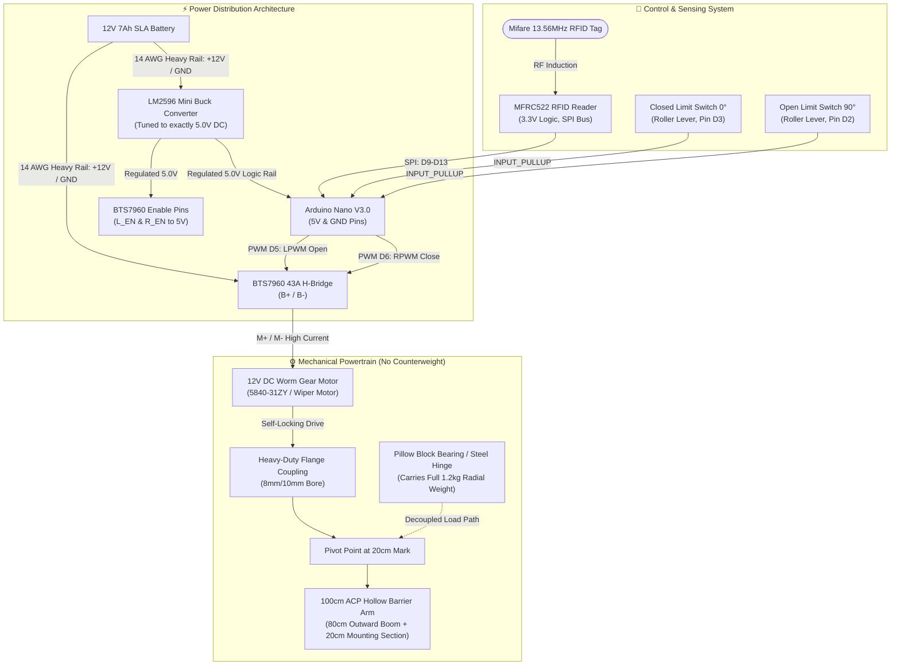

# 🚧 RFID Worm-Gear Barrier Gate System (Nano + BTS7960)

[-00979D.svg?logo=arduino&logoColor=white)](https://www.arduino.cc/)
[]()
[]()
[]()
[-blue.svg)]()
[](LICENSE)
[]()

An industrial-grade, full-scale automated boom barrier gate and access control system. Engineered from first-principles mechatronics, this system drives a **100cm Aluminum Composite Panel (ACP) barrier arm mounted at the 20cm mark** (leaving an 80cm clear boom span) using a high-torque **12V DC worm gear motor (5840-31ZY)** controlled by an industrial **BTS7960 43A H-bridge**. It is powered by a **12V 7Ah SLA battery** with an **LM2596 high-efficiency buck converter**, features physical position tracking via **roller micro limit switches** at 0° (Closed) and 90° (Open), and authorizes entry through a **13.56 MHz MFRC522 RFID transceiver**.

---

## 🏗️ First-Principles Mechatronics Architecture



---

## 📐 Mechatronics & Mechanical Engineering Rationale

### 1. 20cm Pivot Mounting (No Counterweight)
- The barrier is fabricated from a **100cm Aluminum Composite Panel (ACP)** folded/joined into a lightweight hollow rectangular box ($100\times 10\times 5\text{ cm}$, total mass $\approx 1.2\text{ kg}$).
- The flange coupling and pivot axle are fixed at the **20cm mark**:
  - **Front Boom Section:** $80\text{ cm}$ extends outward across the driveway ($m_{front} \approx 0.96\text{ kg}$, center of mass at $0.40\text{ m}$).
  - **Rear Mounting Section:** $20\text{ cm}$ extends behind the pivot ($m_{rear} \approx 0.24\text{ kg}$, center of mass at $0.10\text{ m}$).
- **Net Static Torque at Horizontal (0°):**
  $$\tau_{front} = 0.96\text{ kg} \times 9.81\text{ m/s}^2 \times 0.40\text{ m} \approx 3.77\text{ N}\cdot\text{m} \approx 38.4\text{ kg}\cdot\text{cm}$$
  $$\tau_{rear} = 0.24\text{ kg} \times 9.81\text{ m/s}^2 \times 0.10\text{ m} \approx 0.235\text{ N}\cdot\text{m} \approx 2.4\text{ kg}\cdot\text{cm}$$
  $$\tau_{net} = \tau_{front} - \tau_{rear} \approx 3.53\text{ N}\cdot\text{m} \approx 36.0\text{ kg}\cdot\text{cm}$$
- The **5840-31ZY worm gear motor** produces **$40 - 70\text{ kg}\cdot\text{cm}$** of continuous rated torque, providing comfortable overhead to lift the barrier directly **without needing any counterweight**.

### 2. Radial Load Decoupling: Pillow Block Bearing / Steel Hinge
- A motor shaft should **never** support the static bending moment of a heavy lever arm.
- An external **pillow block bearing (or heavy-duty steel hinge)** mounts to the outer stand to absorb the entire **1.2 kg static weight** of the ACP barrier.
- The motor shaft connects via a **flange coupling** exclusively to provide rotational torque, preventing radial play, shaft deflection, and gear shearing.

### 3. Actuator: Why a Worm Gear Motor (5840-31ZY)?
- **Self-Locking Mechanism:** Worm gear geometry is mechanically non-backdrivable. Once power cuts out, the barrier arm is physically locked in place and cannot be forced up or down by unauthorized vehicles or wind gusts.
- **Zero Holding Current:** Unlike stepper motors or standard servos that consume continuous stall current to stay in position, the worm gear draws **0 mA when resting at 0° or 90°**, preserving battery life.
- **Massive Dynamic Torque:** Handles the uncounterbalanced rotational inertia smoothly when combined with firmware soft-start PWM ramping.

### 4. Enclosure & Spatial Volume (80cm Pipe Column)
- An 80cm tall pipe with a **6-inch radius (12-inch / 30cm diameter)** or **6-inch diameter (15cm)** provides ample internal volume:
  - **Bottom Compartment:** Houses the **12V 7Ah SLA battery** ($15.1\text{ cm} \times 6.5\text{ cm} \times 9.5\text{ cm}$), lowering the center of gravity and stabilizing the stand.
  - **Middle Compartment:** Houses the **LM2596 buck converter**, **BTS7960 motor driver**, and **Arduino Nano**.
  - **Top Compartment:** Houses the **5840-31ZY worm gear motor** aligned with the pivot shaft, with the **RC522 reader** mounted behind a non-metallic RF window.

---

## 🔌 System Wiring & Interconnections

### 1. Power Distribution Architecture
> ⚠️ **CRITICAL:** Do NOT power the Arduino Nano through its onboard VIN pin from 12V. Feeding 12V into the Nano's small linear regulator causes severe thermal throttling and potential burnout. Always step down to 5.0V with the LM2596 buck converter first!

1. Route **12V Battery Positive (+)** to **BTS7960 (B+)** AND **LM2596 (IN+)** using **14 AWG silicon wire**.
2. Route **12V Battery Negative (-)** to **BTS7960 (B-)** AND **LM2596 (IN-)** using **14 AWG silicon wire**.
3. **Tune the LM2596 buck converter:** Before connecting the Arduino Nano, power the buck converter from the 12V battery and turn the multiturn brass potentiometer while measuring output with a digital multimeter until the output reads **exactly 5.00V DC**.
4. Route **Buck Converter 5.0V (+)** to **Arduino Nano (5V pin)**.
5. Route **Buck Converter GND (-)** to **Arduino Nano (GND pin)**.

---

### 2. Complete Microcontroller Pinout Table

| Module / Component | Module Pin | Arduino Nano Pin | Signal / Logic | Notes |
| :--- | :--- | :--- | :--- | :--- |
| **BTS7960 Driver** | **B+ / B-** | *Direct to Battery* | 12V Heavy DC Rail | 14 AWG silicon wire directly from 12V 7Ah SLA |
| **BTS7960 Driver** | **M+ / M-** | *Direct to Motor* | 12V Motor Leads | Swap wires if motor rotates in reverse |
| **BTS7960 Driver** | **L_EN & R_EN** | **5V Pin** | +5V Logic HIGH | Hardwired to Nano 5V rail (permanently enabled) |
| **BTS7960 Driver** | **LPWM** | **Digital Pin 5** | PWM Output (~86%) | Forward actuation: Opens barrier to 90° |
| **BTS7960 Driver** | **RPWM** | **Digital Pin 6** | PWM Output (~86%) | Reverse actuation: Lowers barrier to 0° |
| **BTS7960 Driver** | **GND** | **GND** | 0V Reference | Common system ground bus |
| **Limit Switch (90°)** | **NO Pin** | **Digital Pin 2** | `INPUT_PULLUP` | Active LOW when barrier arm reaches 90° (Open) |
| **Limit Switch (90°)** | **COM Pin** | **GND** | 0V Ground | Return to ground when switch closes |
| **Limit Switch (0°)** | **NO Pin** | **Digital Pin 3** | `INPUT_PULLUP` | Active LOW when barrier arm reaches 0° (Closed) |
| **Limit Switch (0°)** | **COM Pin** | **GND** | 0V Ground | Return to ground when switch closes |
| **RC522 RFID** | **3.3V (VCC)** | **3.3V Pin** | +3.3V DC Supply | ⚠️ **STRICTLY 3.3V! Connecting to 5V destroys module!** |
| **RC522 RFID** | **GND** | **GND** | 0V Ground | Common ground |
| **RC522 RFID** | **RST** | **Digital Pin 9** | Hardware Reset | SPI reset control |
| **RC522 RFID** | **SDA (SS)** | **Digital Pin 10** | SPI Slave Select | Active LOW chip select |
| **RC522 RFID** | **MOSI** | **Digital Pin 11** | SPI MOSI | Hardware SPI Bus Master-Out Slave-In |
| **RC522 RFID** | **MISO** | **Digital Pin 12** | SPI MISO | Hardware SPI Bus Master-In Slave-Out |
| **RC522 RFID** | **SCK** | **Digital Pin 13** | SPI Clock | Hardware SPI Bus Serial Clock |
| **RC522 RFID** | **IRQ** | *Unconnected* | NC | Not required for polling architecture |
| **Status Indicator** | **Green LED (+)**| **Digital Pin 4** | Logic Output (220Ω) | Access Granted confirmation |
| **Status Indicator** | **Red LED (+)** | **Digital Pin 7** | Logic Output (220Ω) | Standby / Access Denied warning |
| **Acoustic Indicator**| **Active Buzzer (+)**| **Digital Pin 8** | Logic Output | Chime on entry, 3x alarm on rejection |

---

## 🛠️ Complete Bill of Materials (BOM) & Pricing

### Pricing in Nigerian Naira (₦ NGN) & US Dollars ($ USD)

| Item | Component | Specification | Role in System | Qty | Est. Cost (₦ NGN) | Est. Cost ($ USD) |
| :---: | :--- | :--- | :--- | :---: | :---: | :---: |
| **1** | **12V Worm Gear Motor** | **5840-31ZY** (12V DC, 30–50 RPM, high-torque) | Self-locking gate powertrain | 1 | ₦18,000 – ₦25,000 | $12.00 – $16.50 |
| **2** | **BTS7960 43A Driver** | Dual IBT-2 H-bridge module (43A peak, 5V logic) | High-current motor H-bridge | 1 | ₦7,500 – ₦12,000 | $5.00 – $8.00 |
| **3** | **12V 7Ah SLA Battery** | Sealed Lead Acid, $15.1\times 6.5\times 9.5\text{ cm}$ | Uninterruptible primary power | 1 | ₦16,000 – ₦22,000 | $10.50 – $14.50 |
| **4** | **LM2596 Buck Converter**| DC-DC step-down module (tuned to 5.0V output) | Safe logic voltage regulation | 1 | ₦1,800 – ₦3,000 | $1.20 – $2.00 |
| **5** | **Arduino Nano V3.0** | ATmega328P @ 16MHz (Type-C / Mini-B) | Central state & logic MCU | 1 | ₦7,000 – ₦10,000 | $4.50 – $6.50 |
| **6** | **RC522 RFID Kit** | 13.56 MHz SPI module with card & keyfob | Contactless authentication | 1 | ₦7,500 – ₦12,500 | $5.00 – $8.00 |
| **7** | **Micro Limit Switches** | KW12 roller lever snap-action switches | 0° and 90° position tracking | 2 | ₦1,200 – ₦2,400 | $0.80 – $1.60 |
| **8** | **Flange Shaft Coupling**| Heavy-duty 8mm or 10mm bore rigid coupling | Motor-to-barrier connection | 1 | ₦2,500 – ₦4,500 | $1.70 – $3.00 |
| **9** | **Pillow Block Bearing** | UCP201/UCP204 or steel pivot hinge | Carries 1.2kg barrier weight | 1 | ₦4,500 – ₦8,000 | $3.00 – $5.30 |
| **10** | **ACP Barrier Material** | Aluminum Composite Panel ($100\times 10\times 5\text{ cm}$ box) | Lightweight 100cm barrier | 1 | ₦5,000 – ₦9,000 | $3.30 – $6.00 |
| **11** | **80cm Enclosure Pipe** | PVC (6"–12" dia.) or mild steel pipe pillar | External mounting column | 1 | ₦6,000 – ₦12,000 | $4.00 – $8.00 |
| **12** | **14 AWG Silicon Wire** | High-strand flexible wire (Red & Black) | Low-resistance 12V power rails| 2m | ₦2,000 – ₦3,500 | $1.30 – $2.30 |
| **13** | **Indicators & Passives**| Green/Red LEDs (5mm), Active Buzzer, 220Ω | Visual & acoustic feedback | 1 set | ₦1,500 – ₦2,500 | $1.00 – $1.70 |
| **TOTAL**| **Full Complete System**| **Industrial Turnkey Hardware Bill of Materials** | **All items included** | — | **₦76,500 – ₦127,400** | **$50.30 – $84.40** |

---

## 📁 Clean Repository Structure

```
rfid-barrier-gate/
├── rfid_barrier_gate/
│   └── rfid_barrier_gate.ino   # Complete, self-contained native Arduino sketch
├── platformio.ini              # Lean PlatformIO build configuration
├── .gitignore                 # Binary and build artifact exclusions
├── LICENSE                    # MIT Open Source License
└── README.md                  # Comprehensive engineering documentation
```

> **Design Choice:** All pin assignments, motor ramping logic, limit switch monitoring, safety timeouts, and whitelist authentication are consolidated cleanly into a single, well-documented [`rfid_barrier_gate/rfid_barrier_gate.ino`](rfid_barrier_gate/rfid_barrier_gate.ino) file. This ensures instant compatibility with the native Arduino IDE without cluttered multiple tabs or include conflicts.

---

## 🚀 Setup & Calibration Guide

### Step 1: Tune the LM2596 Buck Converter
1. Connect the 12V SLA battery leads to the **IN+** and **IN-** screw terminals of the LM2596 module.
2. Place a digital multimeter across **OUT+** and **OUT-** in DC Voltage mode.
3. Turn the small brass screw on the blue potentiometer counterclockwise until the output reads **5.00V DC**.
4. Only connect the output to the Arduino Nano's **5V** and **GND** pins once 5.00V is verified!

### Step 2: Upload Firmware via Arduino IDE
1. Open the **Arduino IDE**.
2. Install the **MFRC522** library by *GithubCommunity / Miguel Balboa* via **Tools > Manage Libraries...**.
3. Open [`rfid_barrier_gate/rfid_barrier_gate.ino`](rfid_barrier_gate/rfid_barrier_gate.ino).
4. Connect the Arduino Nano via USB.
5. In **Tools > Board**, select **Arduino Nano**.
6. In **Tools > Processor**, select **ATmega328P** (or *ATmega328P Old Bootloader*).
7. Select the COM / Serial Port and press **Upload** (`Ctrl+U`).

### Step 3: Direction Test & Verification
1. Power up the 12V battery rail.
2. The Arduino will run its initial homing routine:
   - If the 0° limit switch is unpressed, it will drive in reverse until it makes contact.
   - If the motor spins in the wrong direction, power off and simply **swap the M+ and M- wires** on the BTS7960 terminal.

### Step 4: Enrolling Physical RFID Cards
1. Open the Serial Monitor at **9600 baud**.
2. Tap your card or keyfob against the RC522 reader.
3. The Serial Monitor will print:
   ```
   Scanned Card UID: 4A:2F:81:B3
   >> [ACCESS DENIED]: Unauthorized card scanned!
   ```
4. Copy the hexadecimal bytes into `AUTHORIZED_UIDS` in [`rfid_barrier_gate.ino`](rfid_barrier_gate/rfid_barrier_gate.ino):
   ```cpp
   const uint8_t AUTHORIZED_UIDS[][UID_LENGTH] = {
       {0x4A, 0x2F, 0x81, 0xB3}, // Your card!
       {0xDE, 0xAD, 0xBE, 0xEF}
   };
   ```
5. Re-upload. Scanning your tag will now play a confirmation chime, turn on the Green LED, smoothly ramp open the barrier to 90°, hold for 5 seconds, and gently close the gate.

---

## 📜 License

Open source under the [MIT License](LICENSE).
